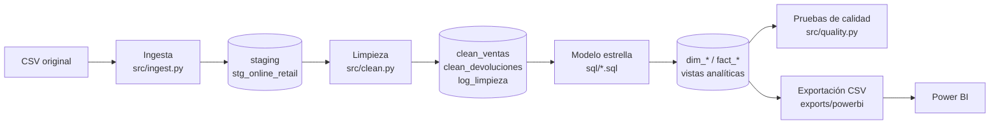
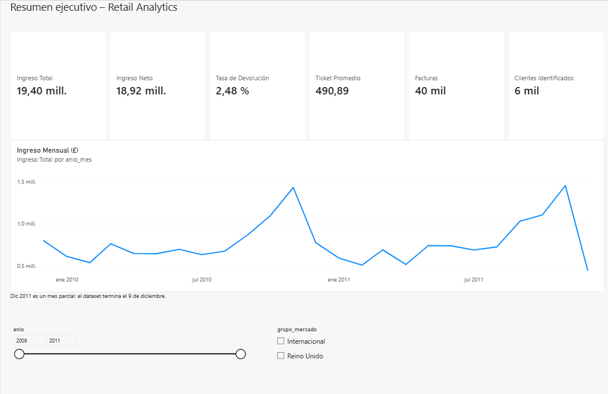
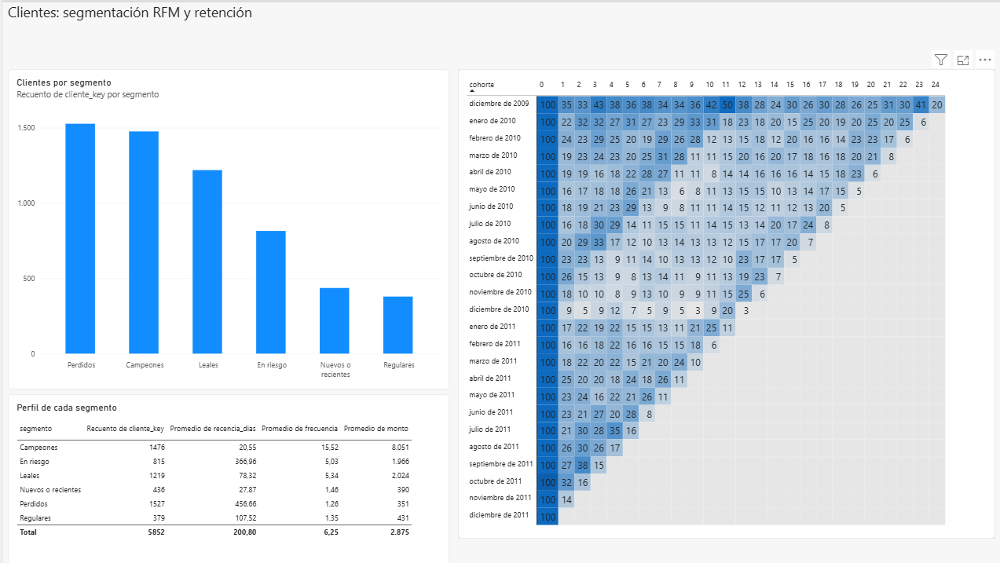
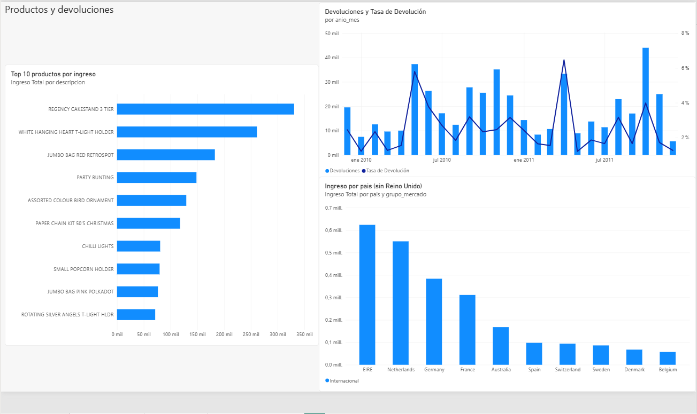

# Retail Analytics Pipeline


Pipeline de datos de punta a punta (ingesta → limpieza → modelo estrella → pruebas de calidad → tablas listas para BI) construido sobre el dataset público **Online Retail II** (UCI Machine Learning Repository): 1.067.371 líneas de factura de una tienda online del Reino Unido, entre diciembre de 2009 y diciembre de 2011.

> > **Estado del proyecto:** pipeline, modelo de datos, pruebas, documentación y dashboard de Power BI terminados. Próximos pasos en el [Roadmap](#roadmap).

## El problema

Los datos crudos no se pueden usar directamente para análisis de negocio. En el EDA ([`docs/hallazgos_eda.md`](docs/hallazgos_eda.md)) encontré, entre otras cosas:

- 22,8 % de las líneas sin `Customer ID`.
- 22.950 cantidades negativas que mezclan devoluciones reales con ajustes de inventario.
- Códigos que no son productos (envíos, ajustes manuales, deuda incobrable).
- Un ajuste contable de **+£11.062** con precio positivo que un filtro de "precio > 0" habría contado como venta.
- Dos pedidos digitados por error (80.995 y 74.215 unidades) cancelados minutos después, que inflaban el ingreso en £245.653.
- 3,2 % de filas duplicadas y un último mes (dic 2011) incompleto.

Este proyecto convierte ese dato crudo en un modelo confiable y documentado, con cada decisión de limpieza trazable.

## Arquitectura



| Capa | Archivo | Qué hace |
|---|---|---|
| Ingesta | `src/ingest.py` | Lee el CSV, valida columnas y lo carga sin transformar a `stg_online_retail` |
| Limpieza | `src/clean.py` | Aplica las reglas del EDA y registra cuántas filas se descartan en cada paso |
| Modelo | `sql/00_…10_*.sql` | Esquema estrella, dimensiones, hechos y vistas analíticas |
| Calidad | `src/quality.py` | 21 verificaciones sobre el modelo; si una falla, el pipeline termina con error |
| Exportación | `src/export.py` | Deja las tablas como CSV para conectarlas a Power BI |
| Orquestación | `src/run_pipeline.py` | Ejecuta todo en orden. Es **idempotente**: correrlo dos veces da el mismo resultado |

## Resultado de la limpieza

Cada fila del log se genera automáticamente (`log_limpieza`) y está verificada por una prueba de conciliación: *filas originales − filas removidas = ventas limpias*.

| Paso | Filas removidas | Filas restantes |
|---|---:|---:|
| Datos originales | 0 | 1.067.371 |
| Quitar códigos que no son producto (POST, M, D, B, C2, DOT…) | 6.094 | 1.061.277 |
| Quitar precio ≤ 0 (ajustes de inventario) | 6.116 | 1.055.161 |
| Quitar 2 pedidos erróneos y sus cancelaciones | 4 | 1.055.157 |
| Separar cancelaciones (facturas C) a tabla de devoluciones | 18.283 | 1.036.874 |
| Quitar cantidades ≤ 0 restantes | 0 | 1.036.874 |
| Quitar duplicados exactos | 33.663 | **1.003.211** |

Las cancelaciones **no se pierden**: quedan en `fact_devoluciones` (18.283 líneas, −£480.866).

**Ingreso limpio: £19.397.022,82** (libras esterlinas). Tasa de devolución: 2,5 % del ingreso.

## Modelo de datos

Esquema estrella con dos tablas de hechos que comparten dimensiones:

```
                 dim_fecha ─────┐
                 dim_producto ──┼──▶ fact_ventas
                 dim_cliente ───┤    fact_devoluciones
                 dim_pais ──────┘
```

| Tabla | Grano | Detalle |
|---|---|---|
| `fact_ventas` | una línea de factura de venta | cantidad, precio unitario, ingreso |
| `fact_devoluciones` | una línea de cancelación | cantidad e ingreso negativos |
| `dim_fecha` | un día (calendario continuo) | año, trimestre, mes, día de la semana, marca de mes parcial |
| `dim_producto` | un código de stock | descripción más frecuente |
| `dim_cliente` | un cliente | incluye el miembro `-1` = *cliente no identificado* |
| `dim_pais` | un país | agrupa en *Reino Unido* / *Internacional* |

Detalle de columnas en [`docs/diccionario_datos.md`](docs/diccionario_datos.md).

## Preguntas de negocio y dónde se responden

| Pregunta | Vista |
|---|---|
| ¿Cómo evolucionan las ventas, el ticket promedio y las devoluciones mes a mes? | `vw_ventas_mensuales` |
| ¿Quiénes son mis mejores clientes y cuáles se están perdiendo? (segmentación RFM) | `vw_rfm` |
| ¿Qué porcentaje de clientes vuelve a comprar N meses después de su primera compra? | `vw_cohortes` |
| ¿Qué productos y países generan más ingreso? | `fact_ventas` + `dim_producto` / `dim_pais` |

## Dashboard

Dashboard en Power BI conectado a las tablas que genera el pipeline (`dashboard/retail_dashboard.pbix`).
> El archivo `.pbix` no se puede previsualizar en GitHub: descárgalo y ábrelo con Power BI Desktop (gratuito, solo Windows). Las capturas de abajo muestran las tres páginas.

**Resumen ejecutivo:** ingreso, devoluciones, ticket promedio y estacionalidad mensual.


**Clientes y RFM:** segmentación de clientes y retención por cohortes.


**Productos y devoluciones:** productos principales, devoluciones y mercados internacionales.


Hallazgo principal: los clientes del segmento *Campeones* (25 % de los clientes identificados) generan cerca del 70 % de su ingreso.
> Para actualizar los datos en otro equipo: ejecuta el pipeline para generar `exports/powerbi/` y, en Power BI, usa *Transformar datos → Configuración del origen de datos* para apuntar a esa carpeta.

## Cómo ejecutarlo

Probado en Python 3.13 con pandas 2.2 y 3.0. No necesita instalar ninguna base de datos.

```powershell
# 1. Crear y activar un entorno virtual
python -m venv .venv
.venv\Scripts\Activate.ps1

# 2. Instalar dependencias
pip install -r requirements.txt

# 3. Colocar el dataset en data/raw/online_retail_II.csv (o en data/)

# 4. Ejecutar el pipeline (≈1 minuto)
python -m src.run_pipeline

# 5. Correr las pruebas
pytest
```

Resultados: la base queda en `warehouse/retail.db` (SQLite) y los CSV para Power BI en `exports/powerbi/`.

**Dataset:** *Online Retail II*, UCI Machine Learning Repository (Daqing Chen). No se incluye en el repositorio por su tamaño.

## Pruebas

`pytest` ejecuta tres grupos de pruebas:

- **Unitarias de limpieza** (`tests/test_clean.py`): cada regla con un caso mínimo.
- **De punta a punta** (`tests/test_pipeline_e2e.py`): el pipeline completo sobre datos de ejemplo, incluyendo idempotencia y vistas.
- **De regresión con datos reales** (`tests/test_regression_real_data.py`): verifica que el pipeline reproduce exactamente los números validados en el EDA. Se omite si el CSV no está disponible.

## Decisiones de diseño

- **SQLite primero, sin instalar nada.** El SQL del modelo es estándar y se porta a PostgreSQL con cambios menores. Prioricé que cualquiera pueda ejecutar el proyecto con un solo comando.
- **Staging sin transformar.** El dato crudo queda intacto en `stg_online_retail`; toda transformación es reproducible desde ahí.
- **Las ventas sin cliente no se descartan.** Se asignan al cliente `-1` para que los totales siempre cuadren. RFM y cohortes las excluyen de forma explícita.
- **Se elimina por tipo de código, no solo por precio.** Un filtro de `precio > 0` no basta (ver el ajuste de +£11.062).
- **Duplicados exactos eliminados.** No hay forma de distinguir un registro doble del sistema de una línea legítima repetida; el riesgo es una subestimación del ingreso de hasta ~2,3 %.

## Limitaciones conocidas

- Diciembre de 2011 es un mes parcial (el dataset termina el día 9); `dim_fecha.es_mes_parcial` lo marca para no compararlo con meses completos.
- La cohorte de diciembre de 2009 incluye clientes que ya existían antes del período observado.
- Los quintiles de RFM son relativos a este dataset.
- Los montos están en libras esterlinas.

## Roadmap

- [ ] Dashboard en Power BI (3 páginas: Resumen ejecutivo, Clientes y RFM, Productos y devoluciones)
- [ ] Migrar el almacenamiento a PostgreSQL con Docker Compose
- [ ] Ejecución automática de pruebas con GitHub Actions
- [ ] Pruebas de datos con dbt

## Estructura del repositorio

```
retail-analytics-pipeline/
├── dashboard/             # dashboard de Power BI (.pbix)
├── data/                  # dataset original (no se versiona)
├── docs/                  # hallazgos del EDA, diccionario de datos e imágenes del dashboard
├── notebooks/             # EDA exploratorio (Colab)
├── sql/                   # esquema, dimensiones, hechos y vistas
├── src/                   # ingesta, limpieza, modelo, calidad, exportación
├── tests/                 # pruebas unitarias, de integración y de regresión
├── warehouse/             # base SQLite generada (no se versiona)
├── exports/powerbi/       # CSV generados para Power BI (no se versiona)
├── requirements.txt
└── README.md
```

## Autor

Marcelo Banchieri Bravo
Estudiante de Ingeniería de Ejecución en Informática, mención Desarrollo de Sistemas
Github: https://github.com/marcelo-banchieri
Linkedin: https://www.linkedin.com/in/marcelo-banchieri-4870b0186/

